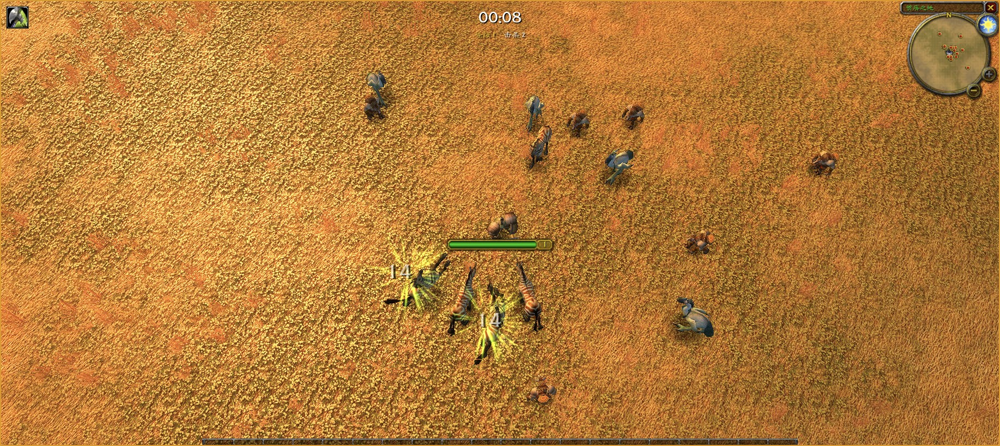
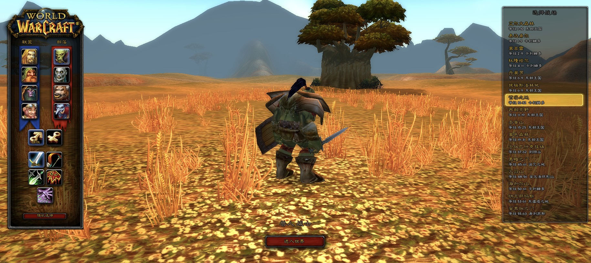
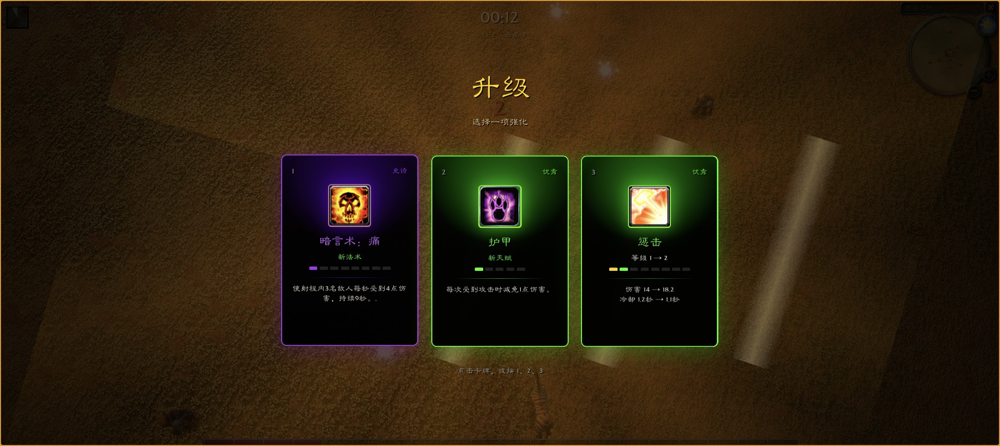
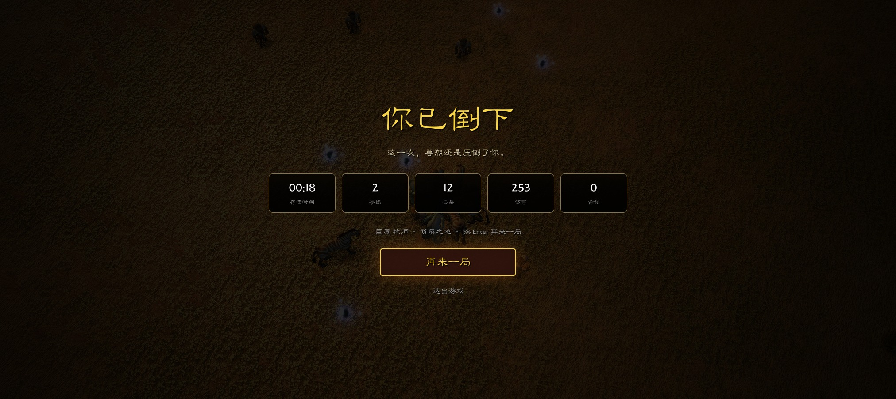

**简体中文（默认）** | [English](README.en.md)



<div align="center">

# Azeroth Survivors

**基于 Rust + [Bevy](https://bevy.org) 的 WoW 1.12.1 客户端引擎，运行在本地的生存类 Roguelite 游戏。**

[](LICENSE-MIT)

</div>

## 项目说明

本仓库 [sqhome-jin/azeroth-survivors-re-cn](https://github.com/sqhome-jin/azeroth-survivors-re-cn)
fork 自 [OutThisLife/azeroth-survivors-re](https://github.com/OutThisLife/azeroth-survivors-re)，用于本地开发与后续功能扩展，中文为默认文档语言。
本分支已加入 zhCN 本地化：默认中文角色/战场选择、Survivors 战斗 HUD 与升级卡，并按 locale 读取客户端 DBC 和 FrameXML 文本。部分自定义或历史硬编码文案仍可能显示英文；切换界面语言时也需要使用对应 locale 的客户端资源。

> **原作与致谢：** Azeroth Survivors 原作由 **[Aethus](https://wow.aethus.pl/)** 制作。
> 可在 [原作网站](https://wow.aethus.pl/) 体验线上版本，参阅
> [发布介绍](https://www.reddit.com/r/wowservers/comments/1x0yidl/azeroth_survivors_roguelike_wow_singleplayer_game/)
> 或加入 [原作 Discord](https://discord.gg/UzxaZuSAk)。
> 本仓库独立维护，不能视为线上版本完整源码或与其功能同步的版本。

选择职业和战场，在敌群中生存：使用 WASD 移动，技能自动释放，击杀敌人获取经验，升级时选择强化，并迎战定时出现的 Boss。
玩法不需要游戏服务器、登录或账号。浏览器版仍需本地 HTTP 服务提供页面和游戏资源；首次构建需要下载依赖与素材。

## 目录

- [当前功能](#当前功能)
- [职业介绍](#职业介绍)
- [快速开始](#快速开始)
- [操作方式](#操作方式)
- [客户端语言](#客户端语言)
- [游戏数据](#游戏数据)
- [架构与开发文档](#架构与开发文档)
- [文档语言](#文档语言)
- [许可与声明](#许可与声明)

## 当前功能

<table>
  <tr>
    <td width="50%"></td>
    <td width="50%"></td>
  </tr>
  <tr>
    <td width="50%"></td>
    <td width="50%"></td>
  </tr>
</table>

- **角色与战场选择**：八个种族、两种性别、符合种族限制的职业组合，以及十六张战场；记住上次选择。
- **本地生存战斗**：每 2 分钟出现 1 位地图主题 Boss，依次增强，共 5 位；10:00 出现最终 Boss，击杀后获胜，最终战可超过 10 分钟。首领使用带地面预警、可走位躲避的原版主题技能。
- **职业法术池**：九职业技能池逐职业翻倍，共 146 个经典旧世主题技能；每局最多 8 个主动技能、12 个被动，另有 F 键机动技能。
- **品质成长卡牌**：主动与被动均不设固定等级上限，普通至传奇卡牌提供不同成长量；同等级的最终数值取决于历次卡牌品质，选卡前显示实际变化。
- **幸运与构筑**：18 类通用被动，包含幸运、额外目标、施法回响、持续时间、射程、暴击威力、吸血和护盾强化；幸运同时影响装备掉率、装备品质与主动／被动卡牌品质。
- **职业机动技能**：5 级解锁，按 F 向光标方向使用，如闪现、冲锋、疾跑等。
- **局外天赋**：九职业均开放三系天赋，每职业 24 节点、最多 51 点；独立累计击杀进度，小兵计 1、首领计 10，局外免费重置。包含持续伤害暴击、冷却刷新、护盾、反伤与 F 键联动。
- **永久装备**：9 个部位、六档品质、共享背包和按职业独立穿戴；精良起拥有技能强化词缀，小兵基础掉率 0.2%（受幸运加成），前四位首领保留原掉落件数，最终首领必得 1 件太古装备，直接进入背包后结算。
- **新版主菜单**：独立角色预览、慢速旋转地图背景、地图说明、装备与天赋入口。
- **战斗信息**：小地图旁显示临时 Buff 图标和倒计时，悬停查看来源与效果；怪物拥有血条，Boss 血条更醒目，可单击或按 Tab 查看目标头像、生命和施法信息。
- **镜头控制**：默认俯视锁定，C 解锁旋转和俯仰，滚轮缩放，最远可至 70 码。
- **画面后处理**：G 切换锐化与色彩调整。
- **中文本地化**：默认 zhCN，覆盖 Survivors 界面和客户端本地化数据提供的文本；部分自定义文案仍可能为英文。

## 职业介绍

九个职业共用“自动施法 + 走位 + 局内选卡”的基础玩法，各有独立技能池与 F 键技能。
点击职业名称查看其技能基础数值、玩法说明、装备方向和实际天赋开放状态；
通用规则见[职业、技能与天赋指南](docs/classes/README.md)。

| 职业 | 特色与开局技能 | F 键技能 | 技能与天赋说明 |
| --- | --- | --- | --- |
| [战士](docs/classes/warrior/README.md) | 顺劈斩开局，近身范围压制、斩杀 | 冲锋 | 9 个自动技能；武器 / 狂怒 / 防护 |
| [圣骑士](docs/classes/paladin/README.md) | 愤怒之锤开局，奉献与免疫窗口 | 自由祝福 | 8 个自动技能；神圣 / 防护 / 惩戒 |
| [猎人](docs/classes/hunter/README.md) | 奥术射击开局，多目标射击与陷阱 | 猎豹守护 | 7 个自动技能；野兽控制 / 射击 / 生存 |
| [盗贼](docs/classes/rogue/README.md) | 邪恶攻击开局，高频近战、流血与眩晕 | 疾跑 | 6 个自动技能；刺杀 / 战斗 / 敏锐 |
| [牧师](docs/classes/priest/README.md) | 惩击开局，护盾、恐惧与伤害回血 | 渐隐术 | 7 个自动技能；戒律 / 神圣 / 暗影 |
| [萨满祭司](docs/classes/shaman/README.md) | 闪电箭开局，弹跳、震击与图腾 | 幽魂之狼 | 8 个自动技能；元素 / 增强 / 恢复 |
| [法师](docs/classes/mage/README.md) | 寒冰箭开局，冰霜控场与火焰爆发 | 闪现术 | 11 个自动技能；奥术 / 火焰 / 冰霜 |
| [术士](docs/classes/warlock/README.md) | 暗影箭开局，持续伤害与直伤机制联动 | 恐惧嚎叫 | 9 个自动技能；24 个天赋节点、51 点 |
| [德鲁伊](docs/classes/druid/README.md) | 愤怒开局，缠绕、持续伤害与恢复 | 急奔 | 8 个自动技能；平衡 / 野性战斗 / 恢复 |

每局最多学习 6 个自动技能，每个最高 8 级；职业技能池并非开局全部拥有。
技能和天赋按本模式重新设计，不应直接套用原版 WoW 的资源、宠物或天赋规则。

## 快速开始

### 环境要求

- 通过 [rustup](https://rustup.rs/) 安装 Rust，项目版本由 [rust-toolchain.toml](rust-toolchain.toml) 指定。
- `make`、`curl`、`unzip` 和 Bash；macOS 还需 Xcode Command Line Tools。
- 浏览器需支持 **WebGPU**，并使用 `localhost` 或 HTTPS 安全上下文；WebGL2 不支持完整世界渲染。
- Windows 请使用 Git Bash 执行脚本，不能直接使用 PowerShell 或 cmd 执行这些 Bash 脚本。

若安装 Rust 后提示 `rustup: command not found`，重新打开终端，或在 Bash / Zsh 中执行：

```bash
source "$HOME/.cargo/env"
```

### 浏览器版

```bash
git clone https://github.com/sqhome-jin/azeroth-survivors-re-cn.git
cd azeroth-survivors-re-cn
make build
make start
```

打开 <http://127.0.0.1:8090/>。首次游戏素材下载约 5.5 GB，另需下载编译依赖和工具链。
浏览器版默认使用 zhCN；可在地址后添加 `?locale=enUS` 切换到英文界面。请同时提供对应 locale 的客户端数据。

`make build` 按顺序运行以下可重复执行的步骤，跳过已完成的相应下载或安装：

| 步骤 | 作用 |
| --- | --- |
| [scripts/fetch-data.sh](scripts/fetch-data.sh) | 下载 WoW 1.12.1 客户端并提取 MPQ |
| [scripts/web-setup.sh](scripts/web-setup.sh) | 配置 WASM 目标、wasm-bindgen、WASI SDK 和 Binaryen |
| [scripts/web-build.sh](scripts/web-build.sh) | 编译浏览器客户端，输出到 `web/dist/` |

### 桌面版

```bash
make native
```

已有素材时，也可以指定自己的 Data 目录直接运行：

```bash
WOW_DATA=/path/to/WoW/Data cargo run --release -p warcraft-survivors
```

运行 `make help` 查看全部目标。**`make clean` 会删除已下载的游戏数据和浏览器构建产物，请谨慎使用。**

## 操作方式

| 按键 | 操作 |
| --- | --- |
| WASD | 移动 |
| Space | 跳跃 |
| F | 职业机动技能，5 级解锁 |
| 鼠标滚轮 | 镜头缩放 |
| C | 切换镜头锁定 |
| 单击怪物或血条 | 选中观察目标；单击空地清除 |
| Tab / Shift+Tab | 正向 / 反向切换可见目标，不改变自动施法选敌 |
| 悬停增益图标 | 查看具体效果、来源和剩余时间 |
| Esc | 暂停 |
| B | 局内打开装备界面 |
| 1 / 2 / 3 | 选择升级卡牌 |
| G | 切换画面后处理 |

完整说明见 [CONTROLS.md](CONTROLS.md)（英文）。

## 客户端语言

客户端默认 locale 为 `zhCN`。浏览器版可用 `?locale=zhCN` 或 `?locale=enUS` 选择；桌面版可设置 `WOW_LOCALE=zhCN` 或 `WOW_LOCALE=enUS`。locale 只选择界面读取的语言，不会转换客户端资源；请让 `WOW_LOCALE` 与 `WOW_DATA`/`--data` 指向的客户端版本相匹配。缺失的单条 DBC 文本会回退到 enUS。

## 游戏数据

仓库不包含暴雪游戏资源文件，如模型、贴图、声音、地图、MPQ 内容和 FrameXML。
运行时需要 WoW 1.12.1 客户端的 `Data` 目录。

默认脚本从 [archive.org](https://archive.org/details/WoW_1.12.1-5875) 下载简体中文 **WoW 1.12.1（build 5875，zhCN）**，
将 MPQ 提取到 `wow-data/Data/`。该目录不纳入 Git，下载支持续传，已有数据会跳过下载。
使用其他来源的游戏数据时，请自行确认获取和使用权限。

### 使用已有素材

桌面版通过 `WOW_DATA` 指定路径；浏览器版可直接用 host 的 `--data` 参数：

```bash
cargo run --release -p wenilla-host -- --www web/dist --data /path/to/WoW/Data
```

本地 host 的资源接口不带登录认证，**不要直接暴露到公网**。

### 更换下载地址

```bash
make build WOW_DATA_URL=https://your-mirror.example/client.zip
```

也可修改 [scripts/fetch-data.sh](scripts/fetch-data.sh) 中的 `DEFAULT_DATA_URL`。
地址必须直接指向包含客户端 `Data/*.MPQ` 文件的 ZIP 压缩包。

## 架构与开发文档

玩法主要位于 [crates/benilla-app/src/survivors](crates/benilla-app/src/survivors)，桌面与浏览器启动器共用同一套 Rust 逻辑。
底层依赖两个上游项目：

- [benilla](https://github.com/samwhosung/benilla)：从零实现的 WoW 1.12.1 客户端。
- [wenilla](https://github.com/Arnesen/wenilla)：浏览器 WASM 移植及相关 host / realm 服务。

| 文档 | 内容 |
| --- | --- |
| [职业、技能与天赋指南](docs/classes/README.md) | 九职业技能池、机动技能、天赋状态及术士完整三系天赋 |
| [中文项目开发指南](docs/PROJECT-GUIDE.zh-CN.md) | 架构、模块、运行流程、功能修改入口和验证建议 |
| [AGENTS.md](AGENTS.md) | 仓库工作约定 |
| [docs/METHOD.md](docs/METHOD.md) | 引擎开发方法与约束 |
| [docs/CONTRIBUTING.md](docs/CONTRIBUTING.md) | 上游引擎贡献规范 |
| [docs/MAP.md](docs/MAP.md) | 自动生成的引擎代码索引 |
| [web/README.md](web/README.md) | 浏览器适配与 JavaScript bridge 说明 |

部分继承文档描述原客户端或其他上游组件，不能直接作为本分支的功能清单；请结合当前源码与中文指南阅读。

## 文档语言

- [README.md](README.md)：简体中文，默认项目入口。
- [README.en.md](README.en.md)：英文版，与中文版保持相同章节和核心信息。
- 修改安装命令、功能范围或重要声明时，请同步更新两版 README；新增语言时在各版本顶部添加互链。

## 许可与声明

Azeroth Survivors 原作由 **Aethus** 制作。本项目与 Blizzard Entertainment 无隶属关系，也未获其背书。
仓库不包含暴雪游戏资源文件；截图展示的是从外部客户端资源渲染的画面，相关美术版权归 Blizzard Entertainment 所有。
World of Warcraft 是 Blizzard Entertainment, Inc. 的商标。

仓库引擎代码采用 [MIT](LICENSE-MIT) 或 [Apache 2.0](LICENSE-APACHE) 双重许可，可任选其一。
[third_party](third_party) 中的第三方组件保留各自的上游许可证。代码许可证不授予暴雪素材的再分发权。
