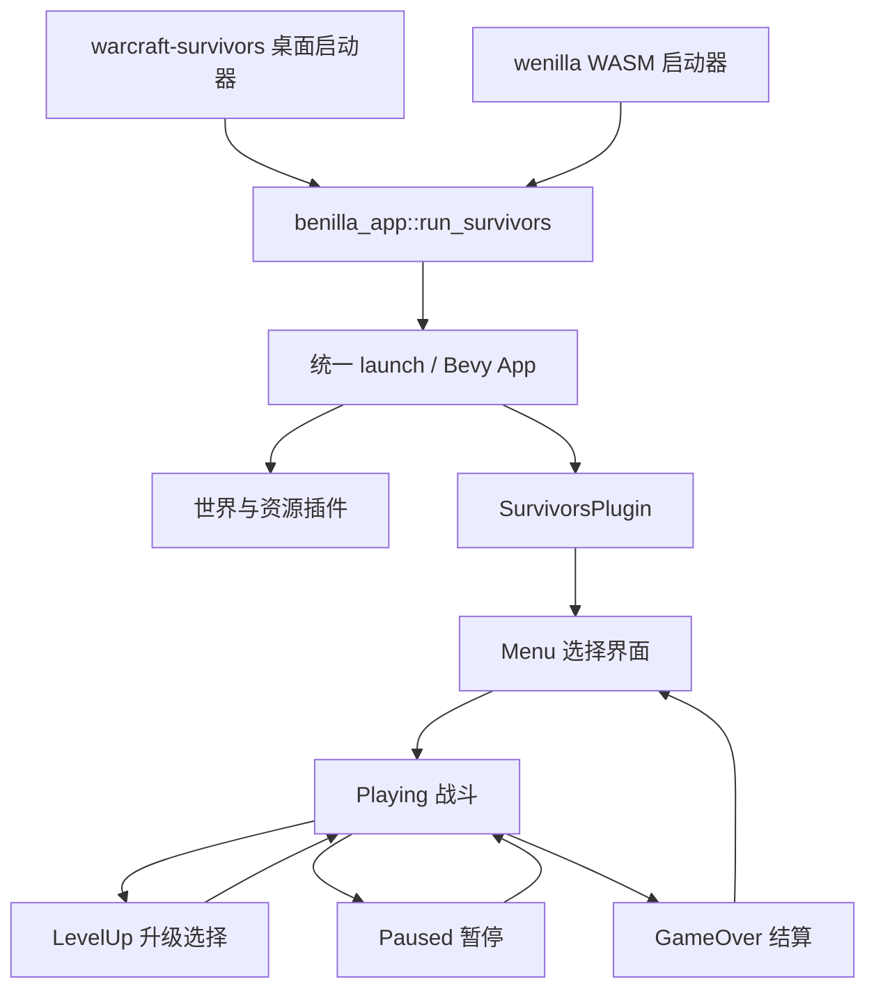
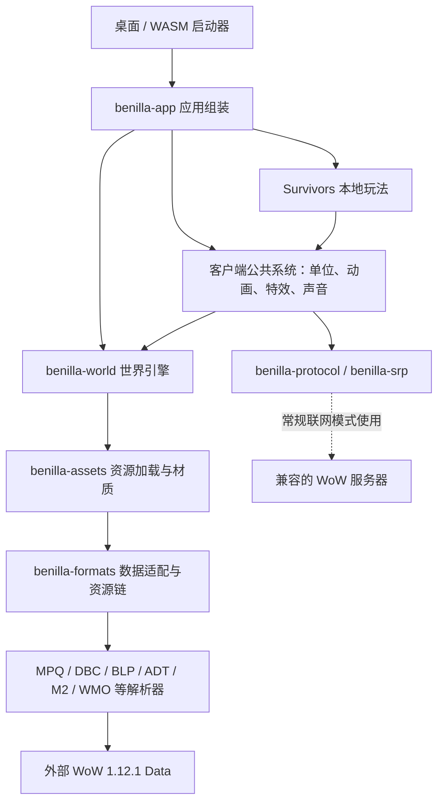

# Azeroth Survivors 项目指南

这份指南面向准备阅读和修改代码的开发者，以当前仓库的实际源码为准。
它介绍项目架构与修改入口，不替代引擎开发规范。

快速导航：[项目定位](#1-项目是什么) · [阅读顺序](#2-从哪里开始读) ·
[启动与状态](#3-运行入口与状态机) · [运行环境](#4-先跑起来) ·
[文档边界](#5-阅读文档时的边界) · [整体架构](#6-整体架构与技术栈) ·
[目录职责](#7-目录与-crate-职责) · [玩法模块](#8-survivors-模块详解) ·
[战斗与成长](#9-一局游戏的数据如何流动) · [浏览器与存储](#10-浏览器资源与持久化) ·
[需求定位](#11-新需求应该改哪里) · [修改步骤](#12-典型扩展的实施路径) ·
[验证与风险](#13-修改后的验证与风险清单)。

## 1. 项目是什么

Azeroth Survivors 是使用 WoW 1.12.1 地图、模型和声音资源的离线生存游戏：
选择职业和地图，移动角色躲避敌群，自动施法，击杀获取经验，升级选择强化。
它不是魔兽服务端，也不是通过插件运行在暴雪客户端里的游戏。

当前仓库建立在两层上游之上：

| 层次 | 职责 | 本仓库中的位置 |
| --- | --- | --- |
| benilla | Rust + Bevy 实现的 WoW 1.12.1 客户端及资源、渲染、协议、UI 能力 | 大部分 `benilla-*` crate |
| wenilla | 将引擎运行在浏览器中，提供 WASM 启动器和本地资源服务 | [crates/wenilla](../crates/wenilla)、[crates/wenilla-host](../crates/wenilla-host)、[web](../web) |
| Survivors | 本地角色、敌人、技能、成长、菜单、结算 | [survivors](../crates/benilla-app/src/survivors) |

**最重要的边界：引擎保留联网客户端能力，但 Survivors 模式的战斗在本地计算，不需要登录和游戏服务器。**
浏览器运行时仍需要本地 HTTP 服务来发送页面、WASM 和游戏资源；“离线”不等于双击 HTML 就能运行。

仓库不包含游戏资源本体。需要可读取的 WoW 1.12.1 Data 目录；源码许可证不授予游戏素材的再分发权。
项目来源与授权说明见 [README](../README.md) 和 [LICENSE-MIT](../LICENSE-MIT)。

## 2. 从哪里开始读

推荐按以下顺序，而不是从庞大的完整客户端 UI 模块开始：

1. [README](../README.md)：产品定位、构建方式和素材来源。
2. [Makefile](../Makefile)：浏览器版和桌面版的常用命令。
3. [桌面启动器](../crates/warcraft-survivors/src/main.rs) / [浏览器启动器](../crates/wenilla/src/lib.rs)：两者最终都调用 `benilla_app::run_survivors`。
4. [应用入口](../crates/benilla-app/src/lib.rs)：`run_survivors` 开启模式标记，再进入统一的 `launch`。
5. [玩法插件与状态](../crates/benilla-app/src/survivors/mod.rs)：系统注册、状态机、局内数据和属性。
6. [玩法定义](../crates/benilla-app/src/survivors/data.rs)：职业、技能、被动和地图。
7. 再按具体需求进入角色、敌人、技能或界面模块。

## 3. 运行入口与状态机



状态枚举 `Phase` 和注册入口 `SurvivorsPlugin::build` 都在
[survivors/mod.rs](../crates/benilla-app/src/survivors/mod.rs)。
玩法借用 `CaptureMode` 禁用常规玩家控制与 FrameXML 生命周期中的相应路径；
这不意味着它只是截图工具，也不意味着整个引擎停止运行。

插件把输入和相机安排在 `WorldStage::Input`，战斗系统随后串行执行：

```text
刷怪 → 敌人移动 → 自动施法 → 区域技能更新 → 伤害结算
     → 状态标记更新 → 掉落 → 经验拾取 → 角色生命与局内状态更新
```

这条战斗链仅在 `Playing` 且加载遮罩不覆盖画面时运行。
升级和暂停状态还会暂停虚拟时间。界面、清理等系统有自己的运行条件，修改时不能只看一个状态枚举。

## 4. 先跑起来

### 浏览器版

```bash
make build
make start
```

默认访问 `http://127.0.0.1:8090/`。
`make build` 依次执行素材获取、工具链安装、WASM 构建；首次素材下载约 5.5 GB。
已有素材时应先核对脚本的跳过条件，避免不必要的下载。

浏览器必须支持 WebGPU。WebGL2 构建选项不等于支持完整世界渲染。
WASM 产物在 `web/dist/`，修改 Rust 或页面源文件后需要重新构建相应产物才能反映到服务页面。

### 桌面版

```bash
make native
```

已有素材时也可以直接运行：

```bash
WOW_DATA=wow-data/Data cargo run --release -p warcraft-survivors
```

玩法开发通常可以先在桌面版验证，再检查 WASM 兼容性。
不要运行 `make clean` 来排查普通问题：它会删除下载的游戏数据和 WASM 构建产物。

### 基础环境

- Rust 工具链以 [rust-toolchain.toml](../rust-toolchain.toml) 为准。
- macOS 需要 Xcode Command Line Tools；Lua 等依赖需要 C 编译工具。
- 浏览器构建还需要匹配版本的 wasm-bindgen、WASI SDK 等，优先使用 [web-setup.sh](../scripts/web-setup.sh)。
- 控制键位见 [CONTROLS](../CONTROLS.md)。

## 5. 阅读文档时的边界

[AGENTS.md](../AGENTS.md) 主要描述继承自 wenilla 的工作方式，
[METHOD](METHOD.md)、[CONTRIBUTING](CONTRIBUTING.md) 和自动生成的 [MAP](MAP.md) 主要描述 benilla 引擎。
这些文档有重要约束，但不是当前 Survivors 产品的完整说明。

例如：文档中提到的 `wenilla-realm`、`benilla-visual`、`benilla-worldview` 并不在当前工作区的 crate 目录中。
不要直接套用它们的构建或部署命令，也不要把引擎“不模拟游戏”的定位误认为当前 Survivors 没有本地战斗。
遇到描述冲突，先核对当前源码、Cargo 配置和实际脚本，再决定适用的流程。

## 6. 整体架构与技术栈



上图是职责关系，不是逐条精确的 Cargo 依赖图。实际依赖以各 crate 的 Cargo 配置为准。

| 技术 | 在项目里的用途 |
| --- | --- |
| Rust 2021 / Cargo workspace | 多 crate 组织、类型约束、原生与 WASM 共用代码 |
| Bevy 0.18.1 | ECS、调度、资源管理、输入、窗口、UI、渲染 |
| wgpu 27 / WGSL | 图形后端与自定义着色器；浏览器世界渲染走 WebGPU |
| avian3d 0.6 | 碰撞体、空间查询等；不能假定完整动力学和接触求解默认开启 |
| Lua 5.1 / mlua 相关依赖 | 常规客户端的 FrameXML、脚本和插件兼容层 |
| kira | 音频混音；输出后端按平台区分 |
| wasm-bindgen / web-sys / JavaScript | WASM 启动、浏览器 API、页面与 Rust 交互 |
| Axum / Tokio / tower-http | 本地 host 的 HTTP、资源读取、静态文件和 WebSocket 中继 |

### 理解 Bevy 代码的四个概念

- **Entity + Component**：实体 ID 及其数据，例如带 `Hero` 或 `Enemy` 标记的单位。
- **Resource**：应用级共享数据，例如当前局 `Run`、选择项 `Selection`、随机数 `Rng`。
- **System**：每帧或状态进入时运行的函数，通过 `Query`、`Res`、`ResMut` 等声明访问数据。
- **Plugin / State / Message**：分别组织系统、控制阶段、传递事件数据；本模式用 `Hit` 和 `Loot` 串起伤害与掉落。

`Commands` 用于延迟生成或删除实体。注册顺序不总等于执行顺序，应查看 `.chain()`、
`.before()`、`.after()`、`.in_set()` 和 `.run_if()`。
修改暂停、加载或战斗时序时，先读 [世界调度约定](../crates/benilla-world/src/schedule.rs)。

世界插件负责“如何呈现场景”，客户端公共系统负责“如何呈现 WoW 单位”，
Survivors 决定“这一局的规则”。通常应优先在最上面的玩法层实现新需求。

## 7. 目录与 crate 职责

根 [Cargo.toml](../Cargo.toml) 使用 `members = ["crates/*"]`。
当前目录中的 crate 可按以下方式理解：

| crate | 职责 | 什么时候需要阅读 |
| --- | --- | --- |
| [warcraft-survivors](../crates/warcraft-survivors) | 桌面 Survivors 启动器、构建标记 | 改启动方式、开发特性 |
| [wenilla](../crates/wenilla) | WASM 入口、panic hook、调用 Survivors | 改浏览器启动 |
| [benilla](../crates/benilla) | 原有客户端启动器 | 研究常规客户端入口，不能当作 Survivors 默认入口 |
| [benilla-buildstamp](../crates/benilla-buildstamp) | 给启动器生成版本与 Git 构建信息 | 改版本展示或构建追踪 |
| [benilla-app](../crates/benilla-app) | 应用组装、完整客户端公共系统及 Survivors | 大多数玩法需求 |
| [benilla-world](../crates/benilla-world) | 地形流式加载、天空、水、光照、模型渲染、碰撞、世界查询 | 改世界渲染和底层性能 |
| [benilla-assets](../crates/benilla-assets) | Bevy 资源源、加载器、模型和材质 | 改贴图、模型或资产缓存 |
| [benilla-formats](../crates/benilla-formats) | 游戏资源链和各类 DBC 业务适配、提取工具 | 查法术、角色、地图等资源数据 |
| [benilla-bytes](../crates/benilla-bytes) | 有边界检查的字节读取和分块解析 | 修复底层文件解析 |
| [benilla-mpq](../crates/benilla-mpq) | MPQ 只读归档解析 | 改归档读取 |
| [benilla-blp](../crates/benilla-blp) | BLP 贴图解码 | 排查纹理解码 |
| [benilla-dbc](../crates/benilla-dbc) | WDBC 表格格式读取 | 排查数据表读取 |
| [benilla-adt](../crates/benilla-adt) | ADT 地形块解析 | 排查地形数据 |
| [benilla-wdt](../crates/benilla-wdt) | 地图地形块索引与坐标工具 | 排查地图布局 |
| [benilla-m2](../crates/benilla-m2) | M2 模型及动画数据解析 | 排查角色、怪物和部分特效资源 |
| [benilla-wmo](../crates/benilla-wmo) | WMO 世界建筑与分组解析 | 排查建筑、室内场景 |
| [benilla-ui](../crates/benilla-ui) | 不依赖 Bevy 的 TOC、FrameXML、布局与脚本基础 | 改原生 WoW UI 兼容性，不是 Survivors 菜单的首选入口 |
| [benilla-protocol](../crates/benilla-protocol) | 原客户端认证与世界协议、对象字段 | 联网客户端或本地单位字段适配 |
| [benilla-srp](../crates/benilla-srp) | SRP6 与世界包头加密 | 认证协议问题 |
| [wenilla-host](../crates/wenilla-host) | 静态文件、MPQ 内文件 HTTP 读取和可选 TCP 中继 | 改本地浏览器资源服务 |

其他目录：

- [web](../web)：页面、启动遮罩、平台集成、可选 bridge 和 JavaScript 测试；不是战斗逻辑所在。
- [scripts](../scripts)：数据下载、工具链、构建、检查与性能探针。
- [third_party](../third_party)：kira、Lua 构建依赖的本地补丁；更新依赖时先看各自的 `BENILLA.md`。
- [reference](../reference)：1.12 API、消息和事件参考目录，不是玩法配置数据库。
- [docs](../docs)：引擎规则、生成索引、性能资料和截图。
- `wow-data/Data/`：外部游戏素材，非源码，保持只读且不提交到 Git。
- `web/dist/`、`target/`：构建产物，不应作为日常修改源文件的入口。

## 8. Survivors 模块详解

所有路径均位于 [survivors](../crates/benilla-app/src/survivors)。

| 模块 | 核心职责与符号 |
| --- | --- |
| [mod.rs](../crates/benilla-app/src/survivors/mod.rs) | `SurvivorsPlugin`、`Phase`、`Selection`、`Run`、`Stats`、`Owned`、`Rng`、暂停和清局 |
| [data.rs](../crates/benilla-app/src/survivors/data.rs) | `CLASSES`、`ABILITIES`、`PASSIVES`、`MAPS`、敌人梯度、经验和难度曲线 |
| [hero.rs](../crates/benilla-app/src/survivors/hero.rs) | 角色生成、移动、跳跃、鼠标瞄准、相机、受伤、生命、死亡和胜利 |
| [abilities.rs](../crates/benilla-app/src/survivors/abilities.rs) | 自动施法、选目标、延迟命中、地面区域、图腾、伤害和效果结算 |
| [enemies.rs](../crates/benilla-app/src/survivors/enemies.rs) | 普通补怪、包围波、Boss、追逐和分离、接触攻击、掉落和经验拾取 |
| [units.rs](../crates/benilla-app/src/survivors/units.rs) | 构造兼容引擎的本地单位和物体、坐标转换、光环标记、特效与飘字适配 |
| [hud.rs](../crates/benilla-app/src/survivors/hud.rs) | HUD、开局、升级候选池与选择、数值说明、图标、冷却、提示和结算 |
| [menu.rs](../crates/benilla-app/src/survivors/menu.rs) | 种族、性别、职业、地图选择，复用 glue 美术，保存和恢复选择；每张地图在区域卡片中有简介（`localization::map_blurb`），面板与按钮使用平铺纹理和渐变 |
| [gear.rs](../crates/benilla-app/src/survivors/gear.rs) | 装备核心：六档品质、9 个部位、14 种普通词缀和 19 种技能强化、共享背包（上限 200）、按职业独立穿戴，存档 `survivors-gear.toml`（v3，兼容升级 v1/v2） |
| [gear_ui.rs](../crates/benilla-app/src/survivors/gear_ui.rs) | 装备界面（主菜单装备栏/军械库、局内按 B 或暂停菜单进入）与主菜单装备栏图标同步 |
| [skill_effects.rs](../crates/benilla-app/src/survivors/skill_effects.rs) | 指定/全局技能强化聚合、周期触发计时、伤害来源、技能吸血、装备独立触发 Buff 与内置冷却、HUD 增益图标 |
| [warlock.rs](../crates/benilla-app/src/survivors/warlock.rs) | 术士天赋的持续伤害暴击、延时、夜幕刷新、目标易伤/虚弱与急速触发；运行状态随局清空 |
| [menu_layout.rs](../crates/benilla-app/src/survivors/menu_layout.rs) | 三栏主界面的布局、装备占位、区域滚动列表和功能提示弹窗 |
| [cards.rs](../crates/benilla-app/src/survivors/cards.rs) | 升级卡牌的品质、发牌、悬停动画和选择交互 |
| [mobility.rs](../crates/benilla-app/src/survivors/mobility.rs) | 5 级解锁的 F 键职业机动技能及其冷却和运行状态 |
| [minimap.rs](../crates/benilla-app/src/survivors/minimap.rs) | 小地图合成、缩放、单位标记和区域文字 |
| [grade.rs](../crates/benilla-app/src/survivors/grade.rs) | G 键切换的锐化和色彩后处理 |
| [fill.rs](../crates/benilla-app/src/survivors/fill.rs) | 自定义 UI 填充材质 |
| [auto.rs](../crates/benilla-app/src/survivors/auto.rs) | 离线玩法的自动选择、移动、升级和观察辅助 |

这里的菜单、HUD、卡牌主要通过 **Rust + Bevy UI** 构建，
不是修改 HTML 就能改变的 DOM，也不是常规 WoW FrameXML 页面。
选择界面的美术与控件会复用 [glue](../crates/benilla-app/src/glue) 的能力。

主菜单采用金色标题与导航、九职业常显网格、角色预览/装备栏、区域详情与滚动列表。
点击任意职业会自动匹配可用种族；种族和性别在“角色”或“种族 / 外观”弹窗修改。
生命值使用所选职业及已应用天赋的真实开局属性，法术池来自职业定义；
区域显示真实敌人等级范围及每 2 分 15 秒一轮、共六轮的首领时间。
角色预览沿用菜单里的实时世界模型；名称按钮仅切换本次预览的展示名，不新增角色存档。
收藏、掉落表、图鉴、成就、奖励、难度、合作保留入口，
点击明确提示“尚未开放”，不伪造收藏进度或种族属性。
装备由击杀掉落（首领必掉）并永久保留；只有主手/副手会改变英雄模型，且在回到主菜单或下一局时刷新，其余部位只影响属性。
小兵每次击杀有 0.2% 概率掉落 1 件装备，首领固定掉落 1 件，不再额外掉落；稀有度权重保持不变。
普通词缀数量减半、数值上下限翻倍。v1 装备存档先一次性升级普通词缀：
每件装备保留原顺序的前一半普通词缀，并将保留词缀的数值翻倍；物品 ID 和穿戴关系不变，之后不会重复翻倍。

| 普通词缀 | 单条取值范围 |
| --- | --- |
| 伤害 | +4%–12% |
| 最大生命 | +6%–16% |
| 移动速度 | +4%–10% |
| 每秒生命回复 | +0.2–0.8 |
| 急速 | +2%–8% |
| 范围 | +4%–12% |
| 拾取范围 | +8%–24% |
| 经验获取 | +4%–12% |
| 护甲 | +0.6–2.0 |
| 暴击几率 | +1%–4% |
| 暴击伤害 | +6%–20% |
| 生命偷取 | +0.2%–0.8% |
| 伤害减免 | +1%–4% |
| 位移冷却缩减 | +2%–8% |

### 装备的技能强化

| 品质 | 普通属性词缀 | 额外技能词缀 |
| --- | --- | --- |
| 普通 | 1 | 0 |
| 优秀 | 2 | 0 |
| 精良 | 3 | 1 |
| 史诗 | 4 | 2 |
| 传奇 | 5 | 3 |
| 太古 | 5 | 4 |

技能词缀分为指定技能和所有相关技能两种；指定技能从掉落职业的法术池生成，所有相关技能不受职业限制，但只作用于支持该参数的技能。
同一件装备最多涉及两个指定技能、最多一条触发 Buff，不重复生成同技能/同类型组合。生成时约 35% 优先选择全局作用范围。
以下为单条取值，百分比加成同类相加，不按装备连乘：

| 强化 | 指定技能 | 所有相关技能 |
| --- | --- | --- |
| 伤害（含护盾、治疗强度） | +25%–50% | +8%–15% |
| 冷却缩减 | 10%–25% | 4%–10% |
| 额外目标/连锁弹跳 | +1–2 | +1 |
| 范围半径/持续时间/施法距离 | +20%–40% | +8%–15% |
| 周期触发频率 | +30%–100% | +10%–30% |
| 每跳伤害保留率 | +5–10 个百分点 | +2.5–5 个百分点 |
| 回响概率（追加 50% 强度命中） | 15%–30% | 7.5%–15% |
| 溅射（3 码内，不重复伤害主目标） | 主伤害的 20%–35% | 10%–17.5% |
| 余烬（额外伤害分 3 秒结算） | 主伤害的 20%–40% | 10%–20% |
| 对生命低于 30% 的敌人增伤 | +30%–60% | +15%–30% |
| 有效伤害转化为治疗 | 3%–6% | 1%–2% |
| 控制持续时间 | +15%–30% | +7.5%–15% |

频率使用 `新间隔 = 原间隔 / (1 + 加成)`，单跳伤害不降低：6 秒内原为每秒 100，+100% 频率后每 0.5 秒 100，6 跳变为 12 跳。
持续伤害、地面区域和图腾都使用实际周期调度；长帧会补齐有效持续时间内的跳数，不因帧率降低而漏跳。
旧技能提示中的“每秒伤害”改为真实间隔及单跳伤害，连锁衰减也显示强化后数值。
频率加成上限 +200%、额外目标 +6（连锁弹跳 +8）、半径/持续时间/射程加成 +100%、冷却缩减 60%、回响概率 50%。
无敌持续时间额外限制为其实际冷却的一半，首领控制抗性保持原规则。
伤害回血只计算敌人实际损失的生命，不计算过量伤害；与原有吸血共享每秒最多 4% 生命上限的恢复预算，不复活角色。原有天赋的持续伤害吸血仍只对持续伤害生效。
回响、溅射、余烬不会递归触发彼此或触发装备 Buff。

**伤害触发 Buff：**指定技能有效伤害每批 30% 概率，全局有效伤害每批 15% 概率；均持续 30 秒，内置冷却从触发时起 30 秒。
一次施法的多个目标、一次区域/图腾/持续伤害跳数中的多个目标只判定一次，不按敌人数重复抽签。

| Buff | 指定技能触发的收益 | 全技能触发的收益 |
| --- | --- | --- |
| 毁灭之力 | 自身所有技能伤害 +30% | +15% |
| 施法狂热 | 急速 +20% | +10% |
| 致命洞察 | 暴击率 +10 个百分点 | +5 个百分点 |
| 灵动疾行 | 移速 +25% | +12% |
| 坚韧护体 | 受到伤害降低 20% | 降低 10% |

同一装备同一效果不叠加、不在冷却期刷新；不同装备的 Buff 可相加，伤害/急速/暴击率/移速/减伤总加成上限分别为 100%/40%/30 个百分点/50%/40%。
卸装立即移除它提供的 Buff，但保留该件装备本局的内置冷却，重穿不能重置。暂停时计时停止，新局重置。
技能在施放时记录参数；换装和触发 Buff 不追溯改写已存在的持续效果，后续新施法应用新属性。
HUD 显示增益图标及每件来源装备的收益和剩余时间；装备详情显示触发概率、收益、持续时间、内置冷却及激活条件。

v1/v2 存档自动升级为 v3：保留有效旧技能强化，按品质补足新条目（稳定随机种子，重复加载不会重新抽取）。
旧存档中与技能不兼容的强化改为该技能的 15%–30% 冷却缩减，保留其余属性，并在日志中提示。
装备详情显示强化启用条件：需由当前职业穿戴，并在本局习得对应技能；跨职业装备的通用属性和兼容的全局技能强化仍生效。
弹窗、天赋和装备界面打开时禁止回车开局，Esc 可关闭角色和占位提示弹窗。

## 9. 一局游戏的数据如何流动

### 9.1 静态定义与运行状态

| 类型 | 保存什么 | 修改时注意 |
| --- | --- | --- |
| `ClassDef` | 职业 ID、初始技能、候选技能池、可用外观和武器 | 初始技能和池中的字符串必须能在 `ABILITIES` 找到 |
| `AbilityDef` | 唯一 key、法术 ID、行为类型、伤害、范围、冷却、持续时间和效果 | 法术 ID 不决定 Survivors 的平衡数值 |
| `PassiveDef` / `Stat` | 被动的每级增量和属性种类 | 新属性还要接入 `Run::stats()` 和 UI 描述 |
| `MapDef` / `Roster` | 地图 ID、出生点、活动边界、普通敌人及 Boss 阵容 | 名称、地图 ID、外观 ID 是不同概念 |
| `Selection` | 菜单选择和实际已进入的地图 `stage` | 选中地图不等于立即切换世界 |
| `Run` | 本局生命、等级、经验、技能、被动、时间、击杀、Buff、统计和待处理升级 | 当前局状态，不等于已有可恢复存档 |
| `Owned` | 已拥有技能的定义、等级和剩余冷却 | 强化后的数值由方法计算，不直接改静态表 |
| `Enemy` / `Gem` | 每个敌人和拾取物的动态状态 | 与显示用 `ObjectStore` 的字段不是天然同步 |
| `RunEntity` | 本局实体标记 | 需要随清局销毁的新实体应遵循该约定 |
| `Progression` / `Loadout` | 各职业累计击杀与永久配点 / 开局锁定的天赋快照 | 不随 `Run` 清空；九职业均开放三系，每职业 24 节点 |

`Run::version` 和 `Selection::version` 是部分界面重建的触发依据。
只改数据却没有相应更新版本，可能出现逻辑生效、图标或预览不刷新的情况。
清局时会保留 GUID 序列，避免跨局仍存活一帧的缓存发生 ID 冲突。

### 9.2 开局

菜单确定职业、外观和地图后，`hud::start_run` 将选择的 `map` 写入 `stage`，
重置 `Run`，添加职业初始技能，并按派生属性设置最大生命。
`hero::follow_map` 等路径配合世界系统更新位置；加载期间战斗链等待遮罩结束。

本地角色、敌人不是简单的 Bevy 裸网格。
`units::spawn_unit` 组装 `Guid`、`NetEntity`、`ObjectStore` 和动画状态，
使现有客户端 attach、动画和法术特效系统可以处理它们，不需要真的发送网络包。

### 9.3 技能计算与命中

```text
AbilityDef 静态参数 + Owned 技能等级 + Run::stats() 派生属性
    → cast_abilities 选目标、判断冷却、触发视觉
    → 直接发 Hit，或存入 PendingHits 等待飞行时间
    → tick_areas 更新区域 / 图腾
    → apply_hits 处理伤害、控制、持续伤害与死亡
    → Loot 消息 → 掉落实体 → 拾取与升级
```

`Kind` 已有投射物、瞬发、近战、环形、锥形、地面区域、链式、持续伤害、
光环、环绕攻击、护盾、免疫、反伤、治疗和图腾等分支。
`Effect` 表达减速、定身、眩晕、恐惧、削弱、吸血和斩杀等附加效果。

当前主要成长规则在 `Owned` 方法中：

- 伤害倍率：`1 + 0.3 * (技能等级 - 1)`，再乘 `Stats.might`。
- 基础冷却每升一级乘 `0.93`，再应用 haste，且存在倍率下限与 0.2 秒冷却下限。
- 在技能 3、5、7 级各增加一个数量。
- 半径每级增加基础值的 8%，再乘 `Stats.area`。
- 持续时间每级增加基础值的 10%。

法术 DBC 除名称、图标和特效外，也提供投射物速度等表现关联信息；
当前命中延迟会读取这个速度。不要把“数值自定义”理解为完全不依赖法术资源。
HUD 的 `cast_at`、卡牌说明和品质判断也依赖最终数值，改公式时需一并核对。

### 9.4 敌人与难度

当前配置包含 9 个职业、16 张可选战场。
地图复用现有世界资源与手写阵容，不会在运行时连接服务器读取真实刷怪点。

- `VICTORY_SECS = 900`：活到 15 分钟触发胜利，不要求先击杀所有 Boss。
- `BOSS_EVERY_SECS = 135`：按阵容顺序生成 Boss；各图当前安排六位，最后一位在 13:30。
- 两次 Boss 之间安排包围波。
- 常规补怪约每 0.12 秒检查一次，每次最多补四个，目标存活数由 `target_alive` 控制。
- 常规目标人数最多 220，但包围波与 Boss 额外生成，所以不是总实体数硬上限。
- 普通敌人池随进度向后移动，生命和伤害再应用 `hp_scale`、`damage_scale`。
- 非贫瘠之地的阵容通过 `ladder` 映射贫瘠之地的数值梯度；改基准梯度会影响多个地图。

敌人主要直接追逐英雄，并用粗网格计算邻居分离，不是完整导航网格寻路 AI。
不要假定所有坡度、建筑和障碍物已经具备与正式 WoW 一样的路径规划。

### 9.5 拾取、升级与结算

`collect_gems` 将经验按 `XP_RATE` 和 `Stats.growth` 放大，
通过 `xp_to_next` 判断升级。一次拾取可能连升多级，以 `pending_levels` 逐次处理。

`hud::choices_for` 对已有技能升级、新技能、被动升级、新被动进行加权抽取，
最多生成三项且本次不重复；候选全部耗尽时提供恢复生命。
当前最多拥有 6 个技能、6 个被动，技能最高 8 级，被动最高 5 级。

品质颜色由卡牌逻辑计算，候选抽取在 HUD 中；若要做“按稀有度控制掉率”，
不能只改卡牌颜色。选择结果由 `hud::pick` 写回 `Run`，处理完待升级次数后回到战斗。

`hero::hurt_hero` 处理免疫、护甲与护盾，`hero_vitals` 处理恢复、Buff、死亡和胜利。
死亡先播放约三秒再进入结算；返回菜单通过 `reset_run` 清理上一局。

## 10. 浏览器、资源与持久化

### 页面与资源链

```text
web/index.html
    → boot.js 加载遮罩、WASM 下载、按 manifest 预取资源
    → wasm-bindgen 生成的 wenilla.js / wenilla_bg.wasm
    → wenilla::start → run_survivors

浏览器中的游戏资源读取
    → GET /data/<文件名>
    → wenilla-host 从本机 Data 的 MPQ 补丁链中读取
    → 返回所需文件 → Rust 解析 → Bevy 资产 → 渲染
```

桌面版直接从磁盘读取补丁链；浏览器版不是把整套 MPQ 先下载到页面再解析。
MPQ 内路径、DBC 行、模型与贴图的转换封装在 formats/assets 层。

[boot-manifest.json](../web/boot-manifest.json) 与
[world-manifest.json](../web/world-manifest.json) 是预取清单，不是职业、关卡或技能配置。
新增玩法应先改 Rust 定义；只有出现新的加载需求时才评估预取清单。

[web-build.sh](../scripts/web-build.sh) 决定哪些页面文件复制到 `web/dist/`。
新增 JavaScript、图片或其他静态模块后，需要确认复制逻辑包含它们。
默认构建还会尝试优化 WASM，并生成可用的压缩副本。

host 的 `/ws/{port}` 是继承的联网中继，只允许指定端口；Survivors 正常离线玩法不依赖它。
**不要把本地 host 当成可直接上公网的产品后端**：`/data` 无认证，会向可访问者发送游戏文件。

### 状态保存

- 桌面状态经 [local_state.rs](../crates/benilla-app/src/local_state.rs) 统一读写。默认 dev 构建通常落在项目的 `benilla-config/`；玩家构建在可执行文件旁，也可通过 `BENILLA_HOME` 指定。
- 浏览器使用 `localStorage`，以虚拟文件路径作为键；不同 origin 的存储独立。
- `menu::save_pick` 保存职业索引、种族、性别和地图索引。重排 `CLASSES` / `MAPS` 时，要考虑旧选择迁移。
- 记住角色选择不等于保存进行中的一局；目前没有在这些玩法入口里看到完整局内恢复机制。
- 新增进度、成就或解锁数据时，应沿用本地状态抽象，不能写进 WoW 安装目录。

### 局外天赋

[面向玩家的职业、技能与天赋指南](classes/README.md)提供九职业入口；
[术士 README](classes/warlock/README.md)列出完整技能池、24 个节点、门槛与合法配点示例。

[talents.rs](../crates/benilla-app/src/survivors/talents.rs) 实现职业独立的长期成长。
九职业均开放三系天赋，每职业 24 个节点。八职业的节点、静态强化在
[talent_catalog.rs](../crates/benilla-app/src/survivors/talent_catalog.rs)，战斗联动在
[class_mechanics.rs](../crates/benilla-app/src/survivors/class_mechanics.rs)；
术士保留原节点 ID 与效果。主菜单的角色、区域、天赋均使用 Bevy UI，不依赖网页 bridge。
天赋节点各自指定独立的原版资源图标路径，按天赋主题和效果选取，不再复用被强化技能的法术图标；
图标通过现有 `UiArt` 加载，职业切换时复用面板实体并更新图文，节点 ID 的职业内唯一性由测试检查。
三系面板使用本地安装资源中对应职业的天赋树
四片背景，按原版 300×331 内容区域裁去补齐边缘。紧凑图标以七层排列，显示等级角标、
可学习/已学习/未解锁状态；连线表示层级进度，不增加单节点前置条件。右侧显示所选天赋、
经验进度、学习/遗忘和重置。只展示已实现的节点，不添加无效果的占位技能。

- 小兵击杀计 1 进度，首领击杀总计 10 进度（不是 11）；以实际死亡计数，不能使用刷怪计数 `Run::bosses`。
- 每职业最多 51 点：前五点分别需新增 100、200、300、400、500 进度；
  第 6～15 点每点需 750，第 16～25 点每点需 1,500，第 26～51 点每点需 2,500；
  累计 89,000 进度达到上限。死亡、胜利、主动放弃均保留已记录进度。
- 每系七层，逐层需要低层累计 0、5、10、15、20、25、30 点；终极节点一级，其余节点五级。
  局外可免费退点、全部重置；草稿应用时校验预算和层级，取消不修改存档。
- 进入一局时锁定天赋。暂停恢复不会重新锁定或恢复生命；局内获得新点数只能在下一局使用。
- 只强化已经取得的技能，不赠送技能、不增加技能槽。恶魔系不依赖尚未实现的宠物系统。
- 战斗与技能提示共用静态施法计算与职业运行时修正；腐蚀术、痛苦诅咒和献祭的持续伤害默认不暴击，
  学习黑暗契约后每跳独立判定，与直伤使用完全相同的暴击率和暴击倍率，包含装备和临时增益。
  痛苦系吸血只取有效伤害（包括暴击后的有效值），
  使用最多储存一秒额度的恢复预算，平均每秒恢复不超过最大生命的 4%。
- 术士保留的常驻属性天赋继续使用 `EFFECT_MULTIPLIER = 2`，例如死亡缠绕每级冷却缩短 8%；
  机制天赋按实际投入等级计算，数值见下表，不再额外乘两倍。终极暴击倍率仍为 3.0
  （基础 2.0 + 加成 1.0），冷却下限与暴击率上限仍生效。
- 新增八职业直接使用实际投入等级，不继承术士的历史双倍系数；相同节点下标不会跨职业生效。
  天赋追加伤害禁止递归触发，按施法批次或脉冲去重，内置冷却随局内时间暂停。
  猎人不新增宠物、德鲁伊不新增变形、萨满增强不新增武器普攻，治疗系适配为单人生存。
  职业独立读取、校验和保存配点；非法配点只返还对应职业，保留其击杀进度及其他职业配点。

#### 术士机制天赋

保留三系 24 个节点、原节点 ID、等级上限、解锁门槛和 51 点总预算；
已有配点直接对应新版效果，不清空击杀或天赋点，局外仍可免费重置。
下列机制替换原节点的纯增伤、固定延时或被动减伤，不额外保留旧属性收益。

| 系别 / 天赋 | 新效果 |
| --- | --- |
| 痛苦 / 恶魔专注 | 腐蚀术、痛苦诅咒、献祭每次有效跳伤有每级 4% 概率延长**当前这一份**持续伤害 1 秒。每份效果累计最多延长初始持续时间的 50%；初始时间包含技能等级和装备。达到上限后不再延长，末跳也可触发；每跳伤害和跳伤间隔不变。 |
| 痛苦 / 夜幕（原暗影掌握节点） | 上述三种跳伤有每级 2% 概率刷新已学直伤法术中**剩余冷却最长**的一个，共用 3 秒内置冷却。候选为暗影箭、献祭、死亡缠绕、灼热之痛、暗影灼烧；没有冷却中的候选时不消耗内置冷却。不赠送技能、不复制施法，下次正常施法更新触发后的冷却。 |
| 痛苦 / 蔓延痛苦 | 上述三种跳伤使目标减速每级 4%，持续 3 秒；首领效果减半。重复命中仅刷新，取现有减速中的较强效果。 |
| 痛苦 / 黑暗契约 | 解锁上述三种持续伤害的逐跳暴击，与直伤共用暴击率/倍率；仍额外提供 2% 持续伤害吸血，与所有吸血共享恢复预算。火焰之雨、地狱烈焰原有的伤害结算不变。 |
| 恶魔 / 恶魔学识大师 | 主要法术造成有效伤害时使敌人虚弱，其伤害降低每级 2%，持续 6 秒；取较强效果、重复刷新，不叠层。与灵魂链接的 20% 角色减伤乘算，首领不免疫虚弱。 |
| 毁灭 / 强化暗影箭 | 暗影箭暴击后，使目标受到主要法术的伤害提高每级 3%，持续 6 秒；直伤、跳伤均受益，触发的那一击不受益。重复施加仅刷新，不叠层。 |
| 毁灭 / 强化献祭 | 暗影箭、献祭、死亡缠绕、灼热之痛、暗影灼烧命中已经有献祭持续伤害的目标时，直伤提高每级 4%。首次施加献祭的直伤不受益；跳伤不受益。与易伤乘算。 |
| 毁灭 / 琥珀风暴 | 献祭的直伤或灼热之痛暴击时获得每级 3% 急速，持续 6 秒，共用 8 秒内置冷却；不叠加，内置冷却期间不续时。真实施法冷却和技能提示均使用临时急速，HUD 显示图标、数值与剩余秒数。 |

只有术士生效；零有效伤害、装备回响/溅射/余烬等派生伤害不会触发这些机制，
派生伤害也不再次享受易伤或献祭联动增伤、不会通过黑暗契约再次暴击。
延时预算属于每份持续伤害，夜幕和琥珀风暴的冷却属于整局角色，不能靠切换目标绕过；
暂停冻结局内时间，重开一局清空运行状态。减速、虚弱、易伤使用现有单位减益标记显示。
延时后的跳伤会在同一长帧中继续补齐，装备提高跳伤频率时仍保持单跳伤害不变。

存档为 `benilla-config/survivors-progress.toml`，浏览器沿用同路径的 `localStorage` 键；
不同源（包括不同端口）互不共享。按职业 ID 与稳定天赋节点 ID 保存，不依赖职业数组顺序。
正常战斗每五秒合并写入，获得点数、应用配点及离开战斗时尽快保存；意外关闭可能损失最后
五秒未保存的击杀，不恢复整局。不能读取的存档进入只读保护并在菜单显示错误，避免覆盖原文件；
不兼容的配点退款且保留击杀。存档在本地，不提供防篡改或联网排名保证。

相关验证命令：
`cargo test -p benilla-app --lib survivors::talents::tests`；
`cargo check --target wasm32-unknown-unknown -p wenilla --no-default-features --features webgpu`。

### 页面配置与 bridge

[webenv.rs](../crates/benilla-app/src/webenv.rs) 将原生环境变量映射为页面配置：
例如 `WOW_SURVIVORS_MAP` 对应 `survivors_map`，优先读 `window.__wenilla_env`，其次读 URL 查询。
这类配置通常在启动时读取，不能假定修改 URL 或全局对象会实时更新已运行的一局。

[bridge.js](../web/bridge.js) 和 [webbridge](../crates/benilla-app/src/webbridge)
提供可选 JavaScript 交互层，但当前页面默认关闭它；加 `?bridge=1` 才请求启用。
继承的 bridge 主要围绕常规客户端快照、Lua 事件和绑定指令设计。
Survivors 的 `Run`、`Phase`、原始按键控制不天然等同于这些接口；
新增网页 HUD、手柄或外部控制前，应先验证快照和指令是否覆盖目标行为，必要时增加明确的玩法接口。

## 11. 新需求应该改哪里

| 需求 | 首选入口 | 必须一起考虑 |
| --- | --- | --- |
| 改伤害、冷却、技能数量 | `data::ABILITIES`、`Owned` | `abilities` 实际结算、HUD 数值预览 |
| 给职业新增技能 | `ABILITIES`、`CLASSES.pool` | 资源 ID、候选池、图标、最高等级 |
| 新技能行为，如召唤伙伴 | `Kind`、`abilities` | 实体生命周期、目标选择、特效、HUD 描述 |
| 新被动属性 | `Stat`、`PASSIVES`、`Run::stats` | 数值消费处、说明与升级预览 |
| 改经验或升级速度 | `xp_to_next`、`XP_RATE`、`collect_gems` | 连升多级、满级候选、暂停恢复 |
| 改升级概率或重选 | `hud::choices_for`、`Offer`、`pick` | 卡牌输入、资源消耗、多次待升级 |
| 改敌人数量和波次 | `target_alive`、`wave_pool`、`spawn_enemies` | CPU、邻居分离、Boss 与包围波额外数量 |
| 新怪物或地图 | `MAPS`、`Foe`、`EnemyDef`、`roster` | display ID、地面高度、边界、菜单容量 |
| 改相机、移动、跳跃、瞄准 | `hero` | 窗口失焦、坐标转换、碰撞、暂停 |
| 改 F 键职业技能 | `mobility` | 解锁等级、冷却 UI、职业 ID |
| 改菜单、HUD、卡牌、小地图 | `menu` / `hud` / `cards` / `minimap` | Bevy UI、缩放、输入竞争，不是只改 HTML |
| 增加长期成长、解锁、成就 | 新的玩法数据 + `local_state` | 数据版本、旧档兼容、双端存储 |
| 网页启动、全屏、音频激活 | `web/index.html`、`boot.js`、`platform.js` | 静态文件打包、浏览器权限、用户手势 |
| 改地形、光照、水、渲染性能 | `benilla-world` / `benilla-assets` | 所有玩法共用，风险比玩法表大 |
| 做多人合作或联网排行榜 | 先明确新协议和服务职责 | 当前无对应产品后端；现有 WoW 中继不等于多人 Survivors |

对于多人合作，需要另外设计状态权威、同步、技能与敌人归属、断线和安全边界，
不是打开现有 WebSocket 开关即可完成。排行榜也应单独考虑验证与防作弊。

## 12. 典型扩展的实施路径

### 新增一个沿用现有行为的技能

1. 在 `ABILITIES` 添加唯一 key，选择合适的 `Kind` 和可用法术 ID，配置玩法数值。
2. 将 key 放入目标职业的 `pool`；只有需要改变初始技能时才改 `start`。
3. 确认该 `Kind` 对 `damage`、`dot`、`radius`、`duration` 等字段的解释符合预期。
4. 检查 `cast_abilities`、目标选择和视觉事件。部分技能使用 key 特判，不能只看类型。
5. 检查卡牌、图标、提示和逐级数值，验证新技能、升级、满级三种状态。

若现有 `Kind` 已能表达需求，优先复用。字符串 key 查不到时 `data::ability` 会 panic，
所以候选池引用完整性很适合用纯数据测试保护。

### 新增一张地图

1. 在 `MAPS` 定义实际 `Map.dbc` ID、WoW 坐标出生点、活动半径和胜利文案。
2. 配置由弱到强的敌人和 Boss，核对外观 ID、模型尺寸和速度。
3. 理解 `ladder` 的跨图数值映射，确认是否仍希望使用公共梯度。
4. 到实际位置检查地形加载、坡度、障碍、镜头和刷怪环，不只验证“地图能打开”。
5. 检查菜单高度和地图列表容量；当前布局不能假定无限增加地图后仍能完整显示。
6. 核对旧配置中的地图索引，避免通过插入条目无意改变玩家记住的战场。

`units::wow_to_bevy([x, y, z])` 返回 `[-y, z, -x]`。
WoW 的 Z 向上，Bevy 的 Y 向上；出生点、距离和方向计算必须区分两套坐标。

### 新增长期进度或局内存档

1. 先区分跨局解锁、设置、本局快照，不要把所有数据直接塞进 `Run`。
2. 沿用 `local_state`，定义有版本号的数据格式及缺失、损坏、旧版本的恢复行为。
3. 技能和地图尽量用稳定 key，而非内存引用或可变列表索引。
4. 局内恢复还要决定技能冷却、敌人、掉落、随机数、待命中事件如何还原。
5. 同时验证磁盘与浏览器存储，确认清局不会误删长期数据。

### 关于扩展边界

应用公开了 `run_with`，但现有 Survivors 模块及多数内部类型不是稳定公开 API。
当前 Survivors 启动方式也不是外部 crate 通过 `run_with` 自动注入的插件。
把玩法完全移到新 crate 并非单纯搬文件，需要先解决可见性和依赖边界；
当前小型玩法需求通常应留在现有模块，避免无关重构。

## 13. 修改后的验证与风险清单

以下是后续开发建议，不代表本次文档工作已经运行这些编译或游戏测试。

### 建议的最小验证

```bash
# 应用改动的原生编译与现有玩法单元测试
cargo check -p warcraft-survivors
cargo test -p benilla-app --lib survivors::hero::tests

# 浏览器兼容性：需要先完成 WASM / C 工具链配置
cargo check --target wasm32-unknown-unknown -p wenilla --no-default-features --features webgpu

# 只在修改对应页面或 host 时增加这些检查
node --test web/tests/*.test.mjs
cargo test -p wenilla-host
```

检查格式可用 `cargo fmt --all -- --check`。
较大的改动再按 [check.sh](../scripts/check.sh)、[gates.sh](../scripts/gates.sh)
和仓库规则运行必要检查。完整检查可能需要素材、额外语料或图形环境，
有些 smoke 步骤面向联网客户端，不能当作 Survivors 的充分验证。

当前 [CI](../.github/workflows/check.yml) 主要覆盖 WASM 检查、浏览器启动测试、
host、部分 UI 与引擎 carry 测试，不是运行完整 Survivors 战斗的端到端测试。
Survivors 目录中当前显式的单元测试集中在角色鼠标失焦释放，
技能数值、候选池、波次与存档的新需求应补对应测试，不要把编译通过当成玩法正确。

优先补充可不依赖素材验证的规则：技能 key 引用完整性、成长上下界、
候选项不重复、达到容量后的行为、地图阵容长度和经验曲线边界。
画面和交互再手动验证：开局、首次升级、暂停恢复、死亡结算、返回菜单后二次开局。

### 双端与生命周期风险

- 浏览器不要直接引入 `std::time::Instant`、`SystemTime`、线程阻塞或原生文件 IO；沿用已有跨平台封装。
- 新系统使用 `Time` 时要明确虚拟时间还是 `Time<Real>`；升级界面需要继续动画，不代表战斗也应继续推进。
- 新实体和延迟事件要能在清局时正确释放，防止第二局出现上一局的伤害或模型。
- 同时检查真实 HP、显示字段、死亡标记与动画，不要只修改其中一个值。
- 修改模型、特效或怪物数量后评估浏览器单线程 CPU 成本；现有分离网格不代表所有算法都已避免高阶复杂度。
- 改浏览器文件后确认进入 dist，改 Rust 后确认已重建，而不是浏览器仍运行旧 WASM。
- wasm-bindgen crate 与 CLI 必须匹配；原生编译通过不能替代 WASM 检查。
- 引擎上游文件的修改受 [AGENTS.md](../AGENTS.md) 的 carry 约束；优先在玩法自有文件中实现，修改前确认适用规则。
- 不提交外部游戏内容，不写入安装目录，不把 host 的资源接口直接暴露到公网。

[auto.rs](../crates/benilla-app/src/survivors/auto.rs) 还提供 `WOW_SURVIVORS_AUTO`、
地图选择和观察辅助，包含 `idle`、`all`、`late` 模式。
这只是测试辅助实现，不是已执行过的验收证明；无人值守运行需遵循仓库约束，
尤其不要把离线辅助功能与联网客户端战斗探针混用。

**实际开发的起点：先把新需求归到“定义、规则、表现、存储、平台”之一，
从上面的需求表选最小入口，再检查它与另外四类的交界。**